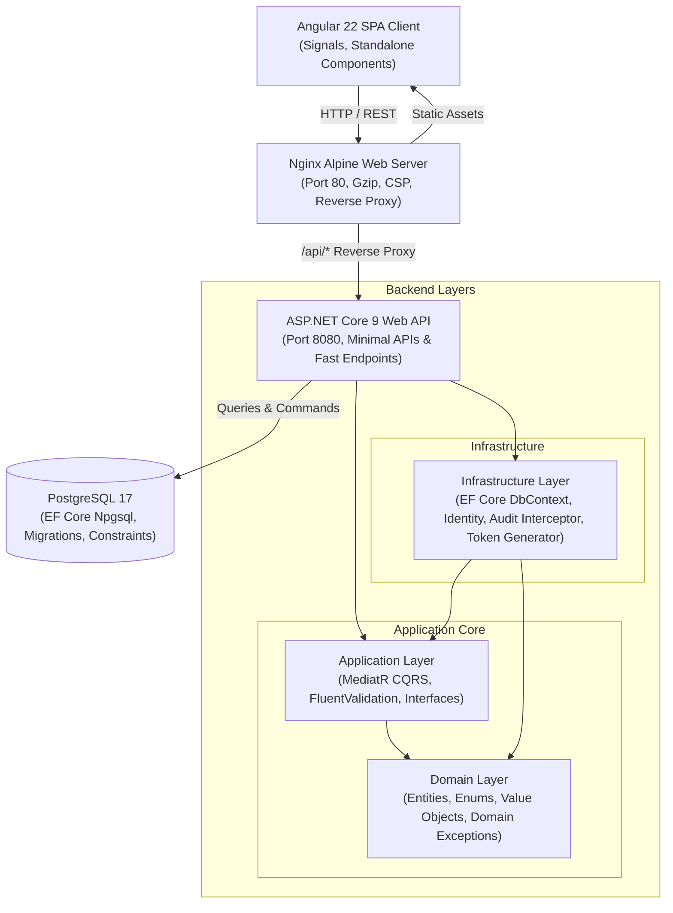

# WorkFlowPro

[](https://github.com/layanpro123456/WorkFlowPro/actions/workflows/ci.yml)


-brightgreen.svg)
-brightgreen.svg)

**WorkFlowPro** is an enterprise-grade Project Management, Service Desk, and Sequential Approval Workflow platform built with **.NET 9 Clean Architecture**, **Angular 22**, and **PostgreSQL 17**. 

Designed for high-reliability business operations, it demonstrates zero-trust role-based access control (RBAC), multi-tenant resource concealment, optimistic concurrency controls, strict data privacy boundaries, immutable audit logging, and automated containerization.

---

## Architecture & System Overview

WorkFlowPro follows **Clean Architecture** and Domain-Driven Design (DDD) principles with a strict unidirectional dependency graph: `Domain` $\leftarrow$ `Application` $\leftarrow$ `Infrastructure` $\leftarrow$ `Api`.



### Architectural Highlights

1. **Domain Invariants & Concurrency**:
   - Task state machine enforces valid status transitions (`Backlog` $\rightarrow$ `ToDo` $\rightarrow$ `InProgress` $\rightarrow$ `Blocked` / `Done` / `Cancelled`) documented in [TASK_TRANSITIONS.md](file:///docs/TASK_TRANSITIONS.md).
   - Optimistic concurrency control via version tokens mapped to `409 Conflict`, preventing lost updates during parallel team edits.
2. **Data-Layer Privacy & Multi-Tenancy**:
   - Requesters in the Service Desk can never view internal staff notes; data filtering is applied at the SQL query projection layer, preventing data leakage.
   - Unauthorized resource requests return `404 Not Found` rather than `403 Forbidden` to prevent object ID enumeration attacks.
3. **Sequential Approval Engine**:
   - Snapshots workflow hierarchy definitions and concrete assigned approvers at submission time ([APPROVAL_WORKFLOWS.md](file:///docs/APPROVAL_WORKFLOWS.md)).
   - Database unique constraint on `(approval_request_step_id)` guarantees decisions cannot be recorded twice.
   - Terminal rejection policy immediately closes the request and cancels downstream pending steps.
4. **Immutable Audit Trails**:
   - Entity Framework Core `SaveChangesInterceptor` records administrative, project, and ticket state transitions into an append-only `audit_logs` table with IP and caller metadata.
5. **System Hardening**:
   - IP-partitioned sliding-window rate limiting on sensitive endpoints (e.g., authentication) returning `429 Too Many Requests`.
   - Comprehensive security headers: `X-Content-Type-Options: nosniff`, `X-Frame-Options: DENY`, `Referrer-Policy: strict-origin-when-cross-origin`, and `Content-Security-Policy`.
   - Correlation IDs (`X-Correlation-Id`) propagated across middleware, exceptions, and structured logs.

---

## Pre-Seeded Demo Accounts

When running via Docker Compose or starting with `SeedDemoData=true`, synthetic enterprise accounts are provisioned with realistic sample data across projects, tasks, tickets, approvals, and notifications:

| Role | Email Address | Password | Intended Capabilities |
|---|---|---|---|
| **Administrator** | `admin@workflowpro.local` | `Password123!` | System-wide governance, user provisioning, role assignments, full audit log access, system metrics. |
| **Project Manager** | `manager@workflowpro.local` | `Password123!` | Project management, task creation/assignment, workflow step reviews, reporting and team velocity dashboards. |
| **Support Agent** | `agent@workflowpro.local` | `Password123!` | Service desk queue triage, ticket assignment, publishing customer replies and private internal notes. |
| **Employee 1** | `employee@workflowpro.local` | `Password123!` | Kanban board participation, support ticket requester, approval request authoring, inbox notifications. |
| **Employee 2** | `employee2@workflowpro.local` | `Password123!` | Second submitter/collaborator for multi-user workflow demonstrations and sequential approvals. |

---

## One-Command Quickstart (Docker Compose)

### Prerequisites
- Docker Engine $\ge$ 24.0 or Docker Desktop
- Docker Compose v2

### Launch Stack
Clone the repository and run:

```bash
# Clone the repository
git clone https://github.com/layanpro123456/WorkFlowPro.git
cd WorkFlowPro

# Build images and start all services
docker compose up --build -d
```

### Access Points
- **Web Application (Angular)**: [http://localhost](http://localhost)
- **API Swagger / OpenAPI**: [http://localhost:8080/swagger](http://localhost:8080/swagger)
- **API Health Liveness Check**: [http://localhost:8080/health/live](http://localhost:8080/health/live)
- **API Health Readiness Check**: [http://localhost:8080/health/ready](http://localhost:8080/health/ready)
- **PostgreSQL Database**: `127.0.0.1:5432` (Internal Docker network only; bound locally for administrative tooling)

### View Logs & Teardown
```bash
# Stream API logs
docker compose logs -f api

# Tear down containers and clean up volumes
docker compose down -v
```

---

## Local Development (Without Docker)

### 1. Database Setup
Ensure PostgreSQL is running locally on port 5432 with credentials matching `.env.example`:

```bash
# Create local database
psql -U postgres -c "CREATE USER workflowpro_app WITH PASSWORD 'CHANGE_ME_LOCAL_DEV_ONLY';"
psql -U postgres -c "CREATE DATABASE workflowpro OWNER workflowpro_app;"
```

### 2. Backend API
```bash
cd backend
dotnet restore WorkFlowPro.sln
dotnet run --project src/WorkFlowPro.Api
# API runs on https://localhost:7001 and http://localhost:5000
```

### 3. Frontend SPA
```bash
cd frontend/workflowpro-web
npm install
npm start
# Web app runs on http://localhost:4200
```

---

## Automated Test Suite & Verification Results

WorkFlowPro is protected by an automated test suite verifying domain invariants, business logic, security permissions, and API contracts.

```text
================================================================================
TEST EXECUTION METRICS (100% Pass Rate)
================================================================================
Backend Unit Tests (WorkFlowPro.UnitTests):         165 Passed (0 Failed)
Backend Integration Tests (WorkFlowPro.Integration): 53 Passed (0 Failed)
--------------------------------------------------------------------------------
Total Backend Tests (.NET 9):                      218 Passed (0 Failed)
Frontend Unit & Component Tests (Vitest):            82 Passed across 22 files (0 Failed)
================================================================================
Total System Automated Tests:                       300 Passed (0 Failed)
================================================================================
Vulnerability Audit (.NET):                         0 Vulnerabilities Found
Vulnerability Audit (npm):                          0 Vulnerabilities Found
Production Angular Build:                           0 Warnings, 0 Errors
================================================================================
```

### Executing Tests Locally

```bash
# Run all backend tests
dotnet test backend/WorkFlowPro.sln --configuration Release --verbosity normal

# Run all frontend tests
cd frontend/workflowpro-web
npm test -- --watch=false

# Run Angular production build
npm run build
```

---

## Core Feature Walkthrough

### 1. Projects & Kanban Task Boards
- Create and configure projects with custom keys (`PRJ-ALPHA`, `PRJ-BETA`), target budgets, and member permissions.
- Interactive Kanban Board organized by statuses: `Backlog`, `ToDo`, `InProgress`, `Blocked`, `Done`, `Cancelled`.
- Drag-and-drop or quick transition dropdowns enforcing domain transition rules with optimistic locking prevention.
- Task detail modal featuring live comment threads and an immutable audit event timeline.

### 2. Service Desk & Support Tickets
- Human-friendly sequential ticket numbering (e.g., `#1001`, `#1002`).
- Strict Internal Notes Privacy: Support agents can post internal notes invisible to ticket requesters. Requesters attempting to submit internal notes receive `403 Forbidden`.
- Role-gated ticket assignment and priority triage (`Low`, `Medium`, `High`, `Urgent`).
- Ticket lifecycle progression: `New` $\rightarrow$ `Assigned` $\rightarrow$ `InProgress` $\rightarrow$ `WaitingForRequester` $\rightarrow$ `Resolved` $\rightarrow$ `Closed`.

### 3. Configurable Multi-Step Approval Engine
- Hierarchical approval flows supporting custom steps and escalation sequences.
- Submission-time approver resolution snapshots preventing mid-flight workflow corruption.
- Dedicated **My Approvals Inbox** highlighting pending decisions with one-click Approve / Reject actions and comment prompts.
- Visual step progression tracker displaying decision history, approver timestamps, and rejection termination states.

### 4. Real-Time In-App Notifications
- Automated notification dispatch on task assignments, comments, ticket status updates, and approval requests.
- Strict user isolation ensuring notification mark-as-read endpoints reject cross-user access with `404 Not Found`.
- Header notification bell with unread count badge and instantaneous deep-link navigation.

### 5. Metrics Dashboard & CSV Reporting
- Role-tailored summary metrics: active tasks, overdue tasks, ticket queues, pending approvals, and managed projects.
- Date-bounded analytics reporting for tasks and service desk tickets with breakdown charts by status and priority.
- RFC 4180 compliant CSV export with proper quotation and delimiter escaping for spreadsheet processing.

### 6. Administration & Security Audit Explorer
- Administrative user provisioning with direct role assignment (`Administrator`, `Manager`, `Employee`, `SupportAgent`).
- User activation/deactivation with automatic invalidation of active refresh tokens.
- Sole-admin protection preventing accidental lockout of the last active administrator.
- Filterable Audit Log Explorer showing timestamps, user identities, action categories, IP addresses, and JSON state diffs.

---

## Database Architecture & ERD

The complete database schema diagram is authored in Mermaid format at [docs/erd.mmd](file:///docs/erd.mmd).

### Primary Database Entities
- **Identity**: `users`, `roles`, `user_roles`, `refresh_tokens`
- **Projects**: `projects`, `project_members`
- **Tasks**: `tasks`, `task_comments`, `task_status_history`
- **Service Desk**: `support_tickets`, `ticket_comments`, `ticket_status_history`
- **Approvals**: `approval_workflows`, `approval_workflow_steps`, `approval_requests`, `approval_request_steps`
- **System**: `notifications`, `audit_logs`

---

## Operational Procedures & Documentation

- [Architecture Specification](docs/ARCHITECTURE.md)
- [API Specification](docs/API_SPECIFICATION.md)
- [Database Schema & Migration Guide](docs/DATABASE.md)
- [Entity Relationship Diagram (ERD)](docs/erd.mmd)
- [Task Transition Matrix](docs/TASK_TRANSITIONS.md)
- [Approval Workflows Design](docs/APPROVAL_WORKFLOWS.md)
- [Security Checklist & Threat Model](docs/SECURITY_CHECKLIST.md)
- [Testing Strategy & Test Plan](docs/TESTING.md)
- [Deployment & Operational Runbook](docs/DEPLOYMENT.md)
- [Database Backup & Recovery Runbook](docs/BACKUP_AND_RESTORE.md)
- [Definition of Done](docs/DEFINITION_OF_DONE.md)

---

## Production Limitations & Future Enhancements

While WorkFlowPro implements enterprise design patterns, the following enhancements are recommended for hyperscale cloud deployments:

1. **Distributed Caching & Outbox Pattern**: Currently, domain notifications and audit events execute within the database transaction. For distributed microservice topologies, an outbox table with RabbitMQ / Kafka event streaming is recommended.
2. **Horizontal WebSockets**: Real-time notifications operate within the application process. For multi-replica deployments behind a round-robin load balancer, configure Azure SignalR Service or Redis Backplane.
3. **Blob Storage**: File attachments for tickets and tasks are designed for external object storage (e.g., S3/Blob) via presigned URLs.
4. **Single Sign-On (SSO)**: The current authentication architecture uses ASP.NET Core Identity with JWT bearer tokens. It is designed to easily plug into enterprise IdPs via OpenID Connect (Azure AD / Okta).

---

## License

WorkFlowPro is open-source software.

