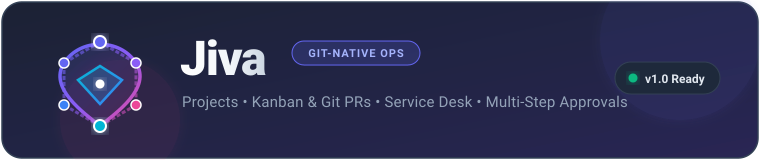
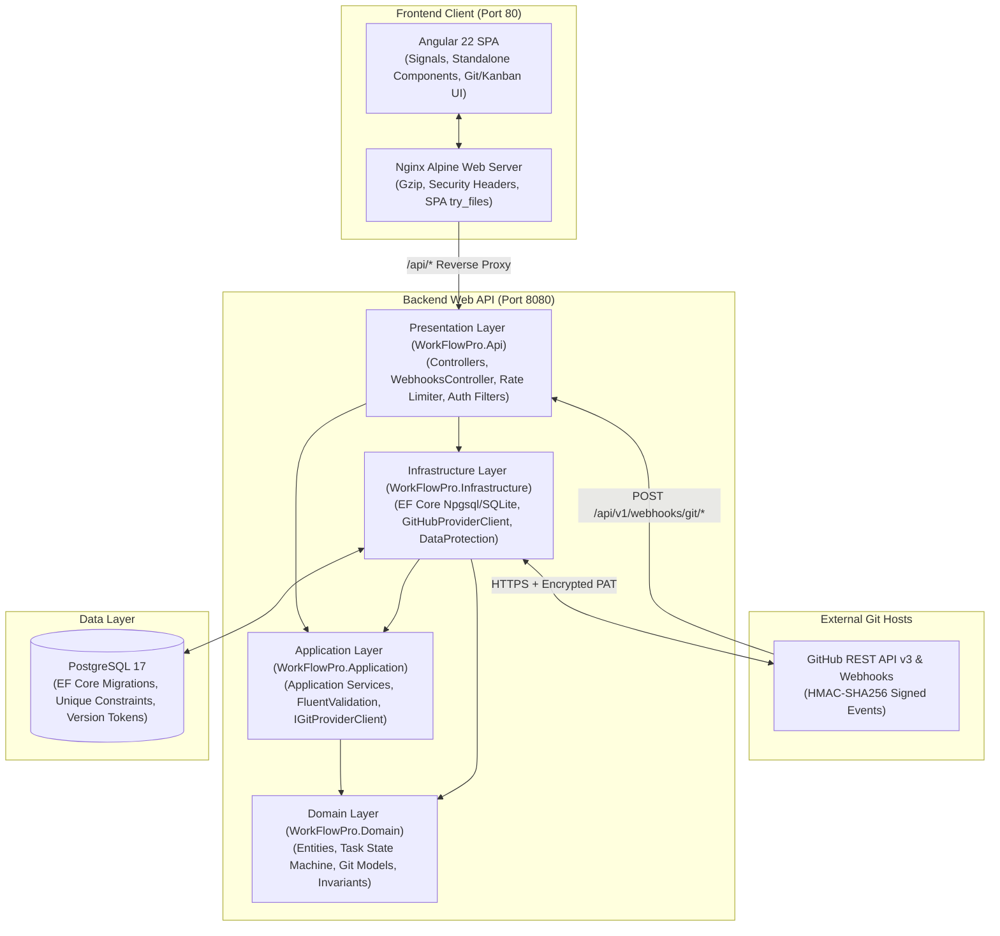

<div align="center">

<a href="https://github.com/layanpro123456/WorkFlowPro">
  
</a>

<br/><br/>

### Modern, Git-Native Project Management, Service Desk & Sequential Approval Engine

*Unifying Kanban task orchestration with live Git branches & Pull Requests, customer support with strict internal notes privacy, multi-step hierarchical approvals, and real-time operational telemetry.*

<p align="center">
  <a href="https://github.com/layanpro123456/WorkFlowPro/actions/workflows/ci.yml">
    
  </a>
  
  
  
  
  
  
  
  
  
</p>

<p align="center">
  <a href="#-key-functionalities--capabilities"><strong>Explore Functionalities</strong></a> •
  <a href="#-one-command-docker-quickstart"><strong>Quickstart</strong></a> •
  <a href="#-pre-seeded-demo-credentials"><strong>Demo Accounts</strong></a> •
  <a href="#-system-architecture"><strong>Architecture</strong></a> •
  <a href="#-automated-testing--quality-gates"><strong>Test Suite</strong></a> •
  <a href="#-documentation-index"><strong>Documentation</strong></a>
</p>

---

</div>

> [!TIP]
> **Experience Jiva in 60 Seconds**: Run `docker compose up --build -d` to launch the complete stack with pre-seeded enterprise datasets, linked Git branches/PRs, and instant role logins for Administrator, Manager, Agent, and Employee roles.

---

## 🌟 Overview

**Jiva** *(codebase/solution `WorkFlowPro`)* is an open-source, full-stack enterprise collaboration platform designed for high-concurrency engineering and business operations. Built on **.NET 9 Clean Architecture**, **Angular 22**, and **PostgreSQL 17**, Jiva eliminates operational friction by providing:

1. **Git-Native Kanban & Task Delivery** with human-friendly task keys (`PRJ-ALPHA-2`), one-click branch creation from cards, live GitHub PR/CI/review badges, HMAC-SHA256 webhooks, and automated card transitions (`InProgress` → `InReview` → `Done`).
2. **Enterprise Service Desk** featuring customer/agent collaboration queues with a strict, data-layer privacy boundary for internal staff notes.
3. **Sequential Multi-Step Approval Engine** with submission-time approver snapshotting, terminal rejection workflows, and double-decision database constraints.
4. **Real-Time Visibility & Reporting** through user-isolated in-app notifications, caller-authorized KPI dashboards, and RFC 4180 compliant CSV exports.
5. **Zero-Trust Administrative Governance** with role-based access control (RBAC), multi-tenant resource concealment, Data Protection-encrypted Git tokens, sliding-window rate limiting, and immutable audit trails.

---

## ⚡ Key Functionalities & Capabilities

Jiva is structured into 9 cohesive functional modules, engineered with strict domain invariants and robust security controls:

### 🚀 1. Identity, Authentication & Zero-Trust RBAC
- **Multi-Tiered Enterprise Roles**: Pre-configured with 4 granular roles: `Administrator`, `Manager`, `SupportAgent`, and `Employee`.
- **JWT Bearer Authentication & Refresh Tokens**: Short-lived (15 min) access tokens paired with secure HTTP-only refresh tokens (7 days) supporting automatic rotation and replay revocation.
- **Multi-Tenant Resource Concealment**: Unauthorized queries return `404 Not Found` rather than `403 Forbidden` to eliminate resource ID enumeration attacks.
- **Sole-Administrator Protection**: Server-side validation prevents the deactivation or demotion of the system's last remaining active administrator.
- **Session Revocation**: Deactivating a user instantly revokes all active refresh tokens, terminating sessions across all devices.

### 📋 2. Project Lifecycle & Membership Governance
- **Scoped Project Workspaces**: Support for distinct project codes (`PRJ-ALPHA`, `PRJ-BETA`), target delivery deadlines, and budgetary tracking.
- **Hierarchical Project Roles**: Scoped memberships (`Owner`, `Manager`, `Member`) governing task assignment and backlog modification rights.
- **Active Member Invariant**: Tasks can only be assigned to verified, active members of that specific project, preventing orphaned or unassigned workloads.

### ⚡ 3. Interactive Kanban Board, Task Keys & State Machine
- **Human-Friendly Task Keys**: Sequential per-project identifiers (e.g., `PRJ-ALPHA-1`, `PRJ-ALPHA-2`) assigned automatically at creation for branch naming and PR matching.
- **Strict Domain State Machine**: Enforces a formal lifecycle transition matrix ([docs/TASK_TRANSITIONS.md](docs/TASK_TRANSITIONS.md)):
  $$\text{Backlog} \longrightarrow \text{ToDo} \longrightarrow \text{InProgress} \longrightarrow (\text{InReview} \mid \text{Blocked} \mid \text{Done} \mid \text{Cancelled})$$
- **Optimistic Concurrency Control**: Uses entity version tokens mapped to `HTTP 409 Conflict`, preventing accidental lost updates when multiple team members edit the same task concurrently.
- **Interactive Dual Views**: Switch seamlessly between a Kanban Board (with `InReview` column, PR/CI badges, PR state filter, and one-click branch creation) and a searchable Table view.
- **Threaded Discussion & History Timeline**: Rich discussion comments and an append-only timeline tracking every status change, including automated Git/PR transitions.

### 🌿 4. Git, Branch & Pull Request Integration (GitHub-First)
- **Provider-Agnostic Architecture**: Built behind `IGitProviderClient` with a full GitHub REST API v3 & Webhook implementation (`GitHubProviderClient`), ready for future GitLab/Bitbucket providers.
- **Per-Project Repository Bindings**: Connect repositories per project with encrypted PATs and webhook secrets (`IDataProtectionProvider` persisted via Docker volume), HTTPS SSRF guards, connection testing, and manual PR sync.
- **Create Branches from Kanban Cards**: Launch a branch (`feat/PRJ-ALPHA-2-slug`) directly from a Kanban card or Task Detail view, automatically moving `Backlog`/`ToDo` cards to `InProgress`.
- **Signed Webhooks & Idempotency**: Validates `X-Hub-Signature-256` with constant-time HMAC-SHA256 comparison (`CryptographicOperations.FixedTimeEquals`) and deduplicates `X-GitHub-Delivery` IDs.
- **Auto-Linking & Auto-Transitions**: Automatically links branches and PRs mentioning a `TaskKey` in the branch, title, or body; advances cards to `InReview` on PR open, `Done` on PR merge, and dispatches in-app notifications for PR opens, merges, review change requests, and CI failures.

### 🎫 5. Service Desk & Support Ticket System
- **Human-Friendly Sequential IDs**: Custom sequential ticket numbers starting at `#1001` for effortless verbal reference and customer communication.
- **Strict Internal Notes Privacy Filter**:
  - Support agents can collaborate privately on tickets via internal notes.
  - **Zero Data Leakage**: Internal notes are filtered out at the database projection layer for ticket requesters.
  - **Hardened Validation**: Non-agent requesters attempting to submit an internal note are rejected with `HTTP 403 Forbidden`.
- **Full Support Lifecycle**: Governs status transitions (`New` $\rightarrow$ `Assigned` $\rightarrow$ `InProgress` $\rightarrow$ `WaitingForRequester` $\rightarrow$ `Resolved` $\rightarrow$ `Closed`).
- **Tabbed Queue Triage**: Dedicated tabs for `All Tickets` (for agents/managers) and `My Tickets` (filtered for the requesting user).

### 🔄 6. Sequential Multi-Step Approval Engine
- **Configurable Step Hierarchies**: Define ordered sequential approval workflows (e.g., *Project Lead Review* $\rightarrow$ *Finance Audit* $\rightarrow$ *Executive Sign-Off*).
- **Submission-Time Approver Snapshotting**: Concrete approvers and step sequences are resolved and locked at the moment of submission ([docs/APPROVAL_WORKFLOWS.md](docs/APPROVAL_WORKFLOWS.md)), preventing mid-flight workflow corruption if definitions change later.
- **Designated-Approver-Only Authorization**: Strict server-side verification ensures only the assigned approver for the active step can record a decision (`HTTP 403 Forbidden` for unauthorized attempts).
- **Terminal Rejection Flow**: A rejection at any stage immediately marks the request as `Rejected` and marks all downstream pending steps as skipped.
- **Concurrency & Double-Vote Safeguard**: Database-level unique constraint on `(approval_request_step_id)` guarantees decisions cannot be recorded twice.
- **Visual Progress Stepper**: Interactive stepper displaying current stage, decision status badges, timestamps, and approver review comments.

### 🔔 7. Real-Time In-App Notifications & Event Bus
- **Automated Activity Events**: Event-driven notifications dispatched automatically upon task assignments, discussion comments, ticket status updates, and approval requests.
- **Strict User Isolation**: Queries and read receipts are bounded strictly to the authenticated caller; attempts to modify another user's notification return `HTTP 404 Not Found`.
- **Dynamic Header Notification Center**: Unread count badge with a dropdown menu allowing one-click read confirmation and direct navigation to the referenced entity.

### 📊 8. Executive Analytics Dashboard & RFC 4180 CSV Reports
- **Role-Tailored Operational KPIs**: Instant metric counts for Assigned Tasks, Overdue Tasks, Open Ticket Queues, Pending Approval Inboxes, and Managed Projects.
- **Bounded Date-Range Telemetry**: Generate detailed task and ticket distribution reports filtered by custom date ranges.
- **RFC 4180 Compliant CSV Export**: High-performance streaming CSV export engine with proper quote-wrapping, comma handling, and newline escaping for spreadsheet tools.

### 🛡️ 9. Administration, Audit Log Explorer & System Hardening
- **User Provisioning & Role Editor**: Provision new team members, adjust global roles, and toggle user active states through an administrative console.
- **Filterable Audit Log Explorer**: Append-only log recording administrative changes, project modifications, and privileged operations with caller IP, user agent, action category, and JSON state diffs.
- **Sliding-Window Rate Limiting**: IP-partitioned sliding-window rate limiters protecting sensitive endpoints (e.g., authentication) returning `HTTP 429 Too Many Requests`.
- **Comprehensive Security Headers**: Pre-configured with `X-Content-Type-Options: nosniff`, `X-Frame-Options: DENY`, `Referrer-Policy: strict-origin-when-cross-origin`, and `Content-Security-Policy`.
- **Correlation ID Tracking**: `X-Correlation-Id` propagated across all middleware, exceptions, and structured logs.

---

## 🚀 One-Command Docker Quickstart

The fastest way to run Jiva is using Docker Compose. The stack includes PostgreSQL 17, the .NET 9 API, and the Angular 22 SPA served via Nginx.

```bash
# 1. Clone the repository
git clone https://github.com/layanpro123456/WorkFlowPro.git
cd WorkFlowPro

# 2. Build images and start all containers in detached mode
docker compose up --build -d
```

### Application URLs & Endpoints

| Service | Endpoint URL | Purpose |
|---|---|---|
| **Web Application** | [http://localhost](http://localhost) | Angular 22 Single-Page Application (served via Nginx) |
| **API Swagger / OpenAPI** | [http://localhost:8080/swagger](http://localhost:8080/swagger) | Interactive API documentation & test console |
| **Health Liveness Check** | [http://localhost:8080/health/live](http://localhost:8080/health/live) | Container liveness check |
| **Health Readiness Check** | [http://localhost:8080/health/ready](http://localhost:8080/health/ready) | Verifies database connectivity and migrations |
| **PostgreSQL Database** | `127.0.0.1:5432` | Bound locally for administrative inspection |

---

## 🔑 Pre-Seeded Demo Credentials

When running via Docker Compose (with `SeedDemoData=true`), the following test accounts are pre-seeded with synthetic projects, tasks, tickets, and approval workflows:

| Role | Email Address | Password | Primary Permissions & Capabilities |
|---|---|---|---|
| **Administrator** | `admin@workflowpro.local` | `Password123!` | System governance, user provisioning, role adjustments, audit log exploration. |
| **Project Manager** | `manager@workflowpro.local` | `Password123!` | Project management, task creation/assignment, workflow step reviews, reporting. |
| **Support Agent** | `agent@workflowpro.local` | `Password123!` | Service desk queue triage, ticket assignment, publishing internal notes. |
| **Employee 1** | `employee@workflowpro.local` | `Password123!` | Task updates, ticket creation, approval request submission, inbox notifications. |
| **Employee 2** | `employee2@workflowpro.local` | `Password123!` | Second submitter/collaborator for multi-user workflow demonstrations. |

---

## 🏗️ System Architecture

Jiva strictly adheres to **Clean Architecture** and **Domain-Driven Design (DDD)**. The core business rules and entities reside entirely in the inner layers and remain independent of frameworks, databases, and UI implementations.



### Architectural Layer Responsibilities

| Layer | Project | Key Responsibilities |
|---|---|---|
| **Domain** | `WorkFlowPro.Domain` | Enterprise business entities (including `ProjectGitRepository`, `TaskGitBranch`, `GitPullRequest`, `TaskPullRequestLink`, `GitWebhookDelivery`), domain exceptions, state transition logic, constants. Zero external dependencies. |
| **Application** | `WorkFlowPro.Application` | Use-case services (`TaskAppService`, `GitIntegrationAppService`, etc.), FluentValidation validators, DTO mappings, `IGitProviderClient` & `IGitSecretProtector` interfaces. |
| **Infrastructure** | `WorkFlowPro.Infrastructure` | EF Core `ApplicationDbContext`, Npgsql/SQLite mapping, ASP.NET Core Identity, `GitHubProviderClient`, `GitSecretProtector` (`IDataProtectionProvider`), JWT generator. |
| **Presentation** | `WorkFlowPro.Api` | REST API controllers (including `GitController` and `WebhooksController`), authentication/authorization, rate limiting (`AuthPolicy`, `WebhookPolicy`), global exception handling, OpenAPI/Scalar docs. |
| **Web Client** | `workflowpro-web` | Angular 22 Single-Page Application with Signals, standalone components, Git/Kanban UI, Vitest test suite, Nginx container. |

---

## 🧪 Automated Testing & Quality Gates

Jiva enforces a strict **100% test pass rate** across both backend and frontend test suites:

```text
================================================================================
AUTOMATED TEST VERIFICATION REPORT (100% PASS RATE)
================================================================================
  Backend Unit Tests (WorkFlowPro.UnitTests):            181 Passed  (0 Failed)
  Backend Integration Tests (WorkFlowPro.Integration):    54 Passed  (0 Failed)
  ------------------------------------------------------------------------------
  Total Backend Tests (.NET 9):                         235 Passed  (0 Failed)
  Frontend Unit & Component Tests (Vitest):               86 Passed  (0 Failed)
================================================================================
  TOTAL SYSTEM AUTOMATED TESTS:                          321 Passed  (0 Failed)
================================================================================
  Production Angular Build (ng build):                    0 Warnings, 0 Errors
================================================================================
```

### Running the Test Suite Locally

```bash
# Run all backend unit and integration tests (.NET 9)
dotnet test backend/WorkFlowPro.sln --configuration Release --verbosity normal

# Run all frontend component tests (Vitest)
cd frontend/workflowpro-web
npm test -- --watch=false

# Run frontend production build
npm run build
```

---

## 💻 Tech Stack & Tools

| Component | Technology | Version | Description |
|---|---|---|---|
| **Backend Framework** | .NET | 9.0 | High-performance Web API runtime with C# 13 |
| **ORM & Data Access** | EF Core / Npgsql | 9.0 | PostgreSQL Entity Framework Core provider with automated migrations |
| **Database** | PostgreSQL | 17-alpine | ACID-compliant relational storage with custom constraints |
| **Architecture Pattern** | MediatR | 12.x | CQRS command/query segregation and pipeline behaviors |
| **Validation** | FluentValidation | 11.x | Strongly-typed business validation pipeline |
| **Frontend Framework** | Angular | 22 | Modern SPA with reactive Signals and standalone components |
| **Frontend Testing** | Vitest | 5.x | Ultra-fast unit testing framework for Angular |
| **Web Server** | Nginx | Alpine | Reverse proxy, static asset delivery, and security headers |
| **Containerization** | Docker & Compose | Multi-Stage | Reproducible builds with unprivileged rootless runtime containers |
| **CI/CD** | GitHub Actions | Ubuntu Latest | Continuous integration testing and Docker build verification |

---

## 📂 Repository Layout

```text
WorkFlowPro/
├── .github/
│   └── workflows/
│       └── ci.yml                 # Automated CI: .NET test, Angular test, Docker build
├── assets/
│   ├── logo.svg                   # Brand banner logo
│   └── icon.svg                   # Brand icon mark
├── backend/
│   ├── WorkFlowPro.sln            # Solution file
│   ├── Dockerfile                 # Multi-stage .NET 9 Alpine container
│   └── src/
│       ├── WorkFlowPro.Api/       # Web API, endpoints, middleware, Swagger
│       ├── WorkFlowPro.Application/# CQRS commands, queries, validators, DTOs
│       ├── WorkFlowPro.Domain/    # Business entities, enums, state machines
│       └── WorkFlowPro.Infrastructure/# EF Core, Identity, interceptors, migrations
├── frontend/
│   └── workflowpro-web/
│       ├── Dockerfile             # Multi-stage Angular 22 + Nginx container
│       ├── nginx.conf             # Nginx reverse proxy & security headers
│       └── src/app/
│           ├── core/              # Authentication, guards, interceptors, API services
│           └── features/          # Auth, Tasks, Tickets, Approvals, Dashboard, Admin
├── tests/
│   ├── WorkFlowPro.UnitTests/     # Domain & Application unit tests (165 tests)
│   └── WorkFlowPro.IntegrationTests/# API & database integration tests (53 tests)
├── docs/                          # Architecture specs, ERD, runbooks, and diagrams
├── docker-compose.yml             # Orchestration for PostgreSQL, API, and Web
├── .env.example                   # Environment configuration template
└── README.md                      # Project documentation
```

---

## 📖 Documentation Index

- 📐 [Architecture Specification](docs/ARCHITECTURE.md) – Deep dive into design patterns and layers.
- 📡 [API Specification](docs/API_SPECIFICATION.md) – REST endpoint contracts and payloads.
- 🗄️ [Database Schema & Migrations](docs/DATABASE.md) – Table schemas, relationships, and indexing.
- 📊 [Entity Relationship Diagram (ERD)](docs/erd.mmd) – Full Mermaid database schema diagram.
- 🔀 [Task Transition Matrix](docs/TASK_TRANSITIONS.md) – Allowed task state transitions.
- 🔄 [Approval Workflow Specification](docs/APPROVAL_WORKFLOWS.md) – Step hierarchies and snapshotting.
- 🛡️ [Security Checklist & Threat Model](docs/SECURITY_CHECKLIST.md) – RBAC matrix and OWASP mitigations.
- 🧪 [Testing Strategy & Test Plan](docs/TESTING.md) – Test levels, coverage, and mocking policies.
- 🚢 [Deployment & Operational Runbook](docs/DEPLOYMENT.md) – Production environment guidelines.
- 💾 [Database Backup & Recovery Runbook](docs/BACKUP_AND_RESTORE.md) – Automated backup scripts and drills.

---

## 🔒 Security & Operational Considerations

- **Secret Management**: No production passwords or JWT keys are committed to source control; configuration is driven through environment variables.
- **Rootless Containers**: The API container executes as unprivileged user `$APP_UID` (`app`), mitigating host escape vulnerabilities.
- **Isolated Database Networking**: PostgreSQL is not exposed to the public internet; traffic is confined to the internal Docker bridge network.
- **Scalability Note**: For horizontally scaled deployments across multiple server instances, configure a Redis backplane for distributed rate limiting and SignalR notifications.

---

## 📄 License

Jiva (WorkFlowPro) is open-source software provided under the [MIT License](https://opensource.org/licenses/MIT).
